<!--
  Arcade edition. Every graphic in /assets is a hand-built SVG.
  The fx-*.svg charts are rebuilt daily by scripts/build_charts.py via .github/workflows/charts.yml.
-->

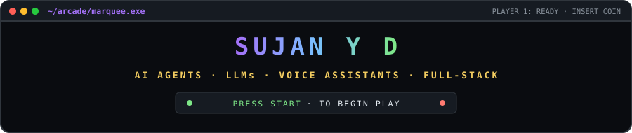

  

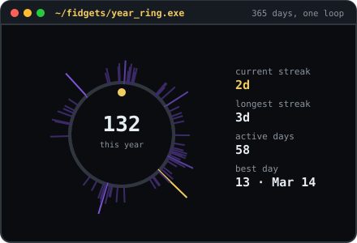

  

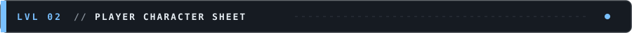

  

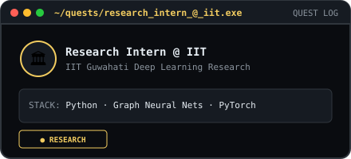

play live: <a href="https://chatgpt-clone-two-bice.vercel.app/">chatgpt-clone</a> &nbsp;·&nbsp;
<a href="https://my-project-hub-two.vercel.app/">my-project-hub</a>

  

  

  

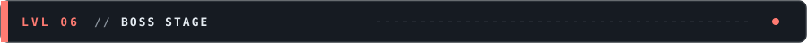
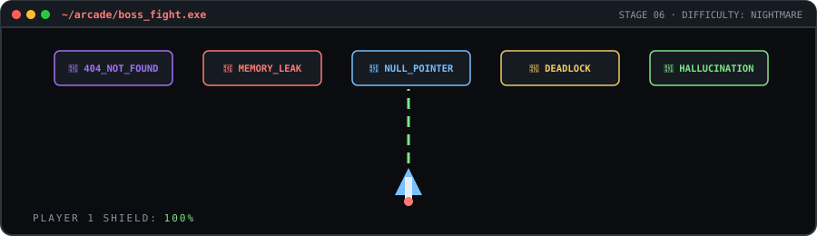

  

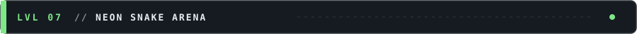

  

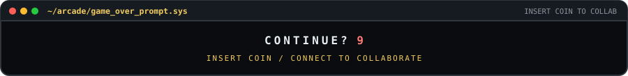

